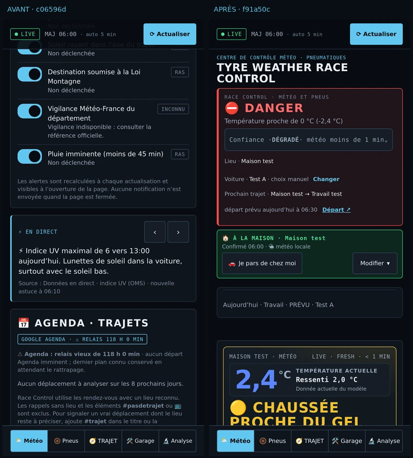
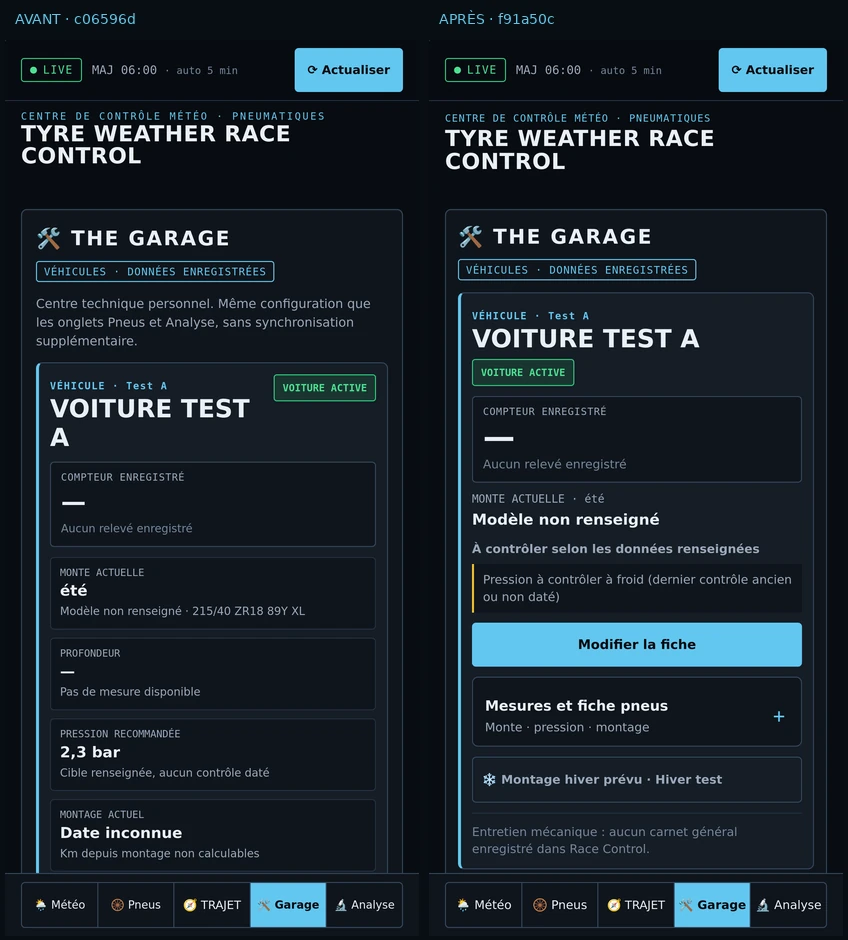
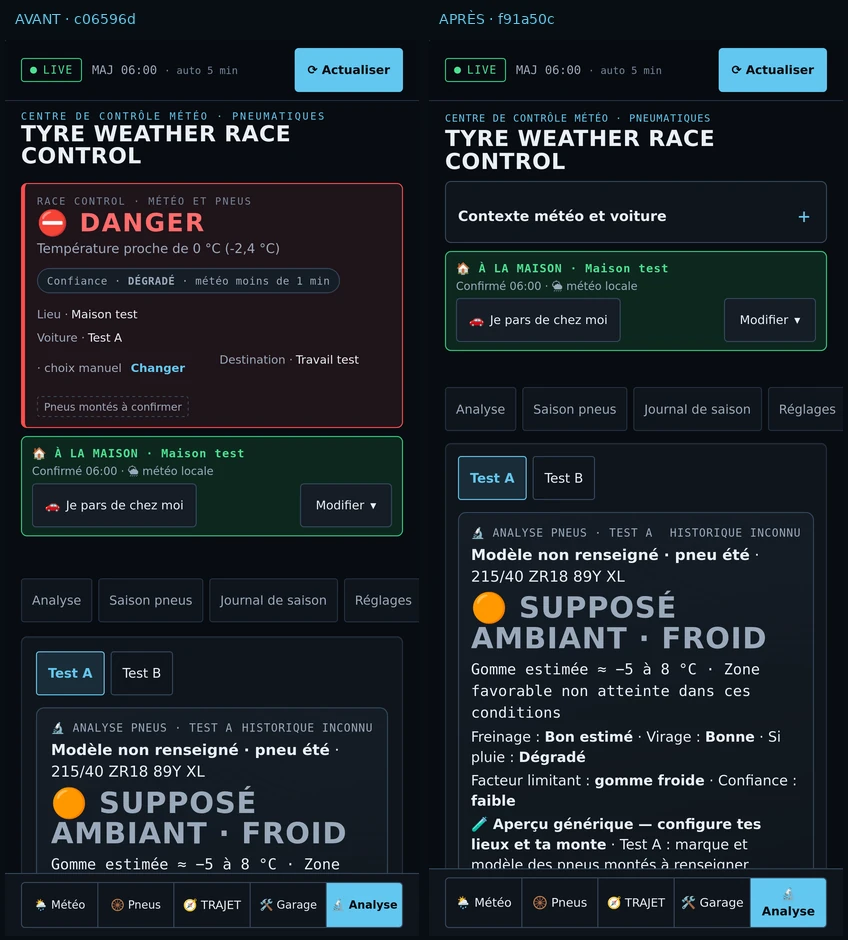
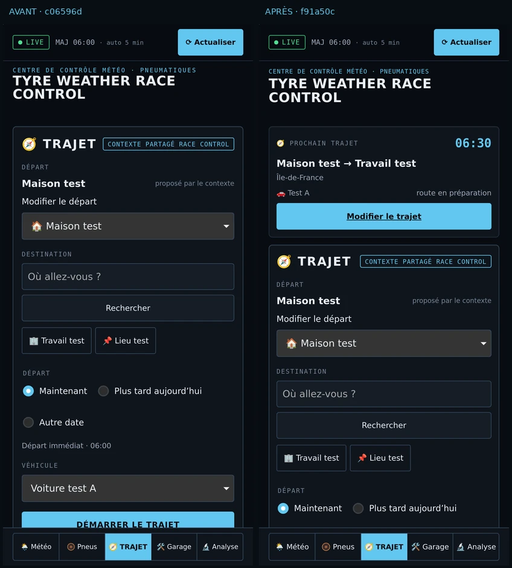

# Race Control — Mobile UX Precision

Référence contrôlée avant intervention : production **prod-92**, SHA `c06596d600c933a89f38424139879bb0bfdc9d62`, build `914cedb6c27b`. Le `version.json` servi correspond à cette version. Appareil prioritaire : iPhone 11 Pro Max, 414 × 896 points ; autres largeurs : 375 et 320 points ; PC : Chromium et WebKit.

## Audit et plan ciblé

| Surface | Encombrement constaté dans le rendu existant | Correction de présentation |
|---|---|---|
| En-tête | Titre haut, raisons de confiance et contexte répétés | Titre mobile plus compact ; raisons détaillées consultables, verdict et confiance toujours visibles |
| Météo | Chronologie, phénomènes et facteurs routiers ouverts successivement | Verdict et prochain trajet conservés ; prévisions et calcul du score repliables |
| Pneus | Pression, DOT et projections avant la recommandation ; voiture active peu repérable | Monte dans la synthèse, badge de voiture active, mesures et historique regroupés |
| Garage | Quatre cases techniques par véhicule, paragraphe d'architecture en tête | Compteur, monte et contrôles d'abord ; fiche pneumatique repliable ; véhicule actif placé en premier |
| Analyse | Fenêtre thermique, freinage, adhérence, aquaplaning et projection ouverts à la suite | Conclusion et confiance conservées ; modèle et projection à la demande ; pression basse toujours directement visible |
| Trajet | Formulaire sans résumé de l'itinéraire au-dessus | Résumé canonique du trajet avant le formulaire ; une commande « Modifier le trajet » |

Les blocs natifs `details/summary` reprennent la palette actuelle. Leurs états de déploiement restent uniquement en mémoire pendant la session. Aucune nouvelle préférence persistante, aucune migration ni modification d'algorithme. La répétition d'un rendu identique conserve les cartes Pneus et leurs commandes ; le focus des nouvelles sections est restauré lors d'une vraie actualisation.

Le titre garde sa taille compacte adaptée à la largeur et les raisons s'ouvrent depuis l'indicateur de confiance. Sur Pneus, le prochain trajet conserve sa priorité historique et la monte apparaît dès la synthèse. Le contexte météo général devient dépliable sur Analyse. Dans Garage, la commande de fiche précède les détails techniques. Le HTML comparé par les gardes de rendu n'inclut plus l'état ouvert/fermé : ouvrir une section ne recrée pas les commandes lors du prochain rafraîchissement.

## Périmètre conservé

Les cinq onglets et leurs commandes historiques, les six modules F1 optionnels, les deux fiches véhicule, les mesures et historiques, les règles météo/agenda/GPS/route, le coffre, les sauvegardes, le Service Worker et le relais restent présents. Aucun kilométrage, contrôle ou rendez-vous n'est inventé. Les heures et distances du résumé viennent du contexte et des trajets existants.

## Validation et captures

Les 46 suites unitaires ont réussi pendant le développement. La matrice complète, le build, le relais, la confidentialité, le profilage et la QA Agenda doivent réussir sur le SHA final avant fusion. Le nouveau scénario `e2e72-mobile-ux.js` contrôle les cinq onglets à 414, 375 et 320 points et sur PC : déploiements au toucher, focus, débordements fermés et ouverts, cibles tactiles, source véhicule inchangée, rechargement et consultation hors ligne.

Les régressions métier Météo, Analyse, usure, pression et Garage continuent à contrôler les mêmes données après déploiement des nouvelles sections. Aucun test n'est désactivé. Les captures du nouveau scénario sont publiées par l'artifact `place-qa` existant. Le profilage compare également les cinq premiers écrans avant/après sur des fixtures identiques ; les PNG sont encodés dans `visuals[].pngBase64` de son artifact JSON existant, pour éviter tout changement de workflow ou de permissions.

Le scénario de lieu personnalisé attend explicitement la fin de l'écriture du coffre avant sa navigation de rechargement ; le code du coffre et les tests de sauvegarde/hors ligne restent inchangés. La nouvelle suite vérifie aussi la présence de l'information ou de l'action essentielle au-dessus de la navigation sur 414 points, pas seulement la visibilité dans le DOM.

Les navigateurs ne peuvent pas être lancés dans l'environnement local utilisé pour cette intervention (restriction système sur les sockets). Les résultats de rendu et captures seront donc ceux des runners GitHub ; aucun résultat local de navigateur n'est revendiqué.

### Comparatif visuel reproductible

Captures issues du [profilage comparatif GitHub 38169912468](https://github.com/iPoower/iPoower/actions/runs/38169912468), avec le même profil fictif, les modules optionnels désactivés dans les deux vues et les détails repliés. Avant : production stable `c06596d`. Après : sources UI `f91a50c`. WebKit 26.6, Playwright 1.63, viewport 414 × 896, DPR 3 ; les paires ci-dessous sont réduites à DPR 1 pour la lecture. Les PNG originaux restent dans l'artifact de profilage. Aucun profil personnel n'est utilisé.

| Onglet | Hauteur du document avant | Après | Observation |
|---|---:|---:|---|
| Météo | 11 823 px | 10 308 px | Prévisions et calcul routier à la demande |
| Pneus | 8 808 px | 8 718 px | Monte dans la synthèse ; détails techniques repliés |
| Garage | 1 845 px | 1 595 px | Compteur et action avant les mesures avancées |
| Analyse | 4 873 px | 3 277 px | Contexte secondaire replié ; diagnostic visible plus tôt |
| Trajet | 1 044 px | 1 230 px | Résumé utile ajouté au-dessus du formulaire |

La hauteur totale n'est pas à elle seule une mesure d'ergonomie. Les avertissements restent présents, les champs gardent leur taille tactile et le résumé Trajet augmente volontairement la page. Le profilage avec les six options F1 activées confirme séparément la conservation des commandes, du focus, du brouillon de départ et du panneau utilisateur, sans mutation F1 ou Garage sur 20 rendus identiques. Aucun débordement horizontal n'apparaît dans les captures PC et iPhone des deux moteurs.

## Protections et limites

La lecture de la branche confirme `main` protégée avec les contrôles `unit`, `scan` et `validation`. Le ruleset actif de `gh-pages` interdit suppression et réécriture, sans bypass. La lecture administrative détaillée de `main/protection` renvoie 403 pour l'intégration : la liste administrative complète des exigences n'est pas affirmée. Aucun réglage de protection n'est modifié.

Une simulation WebKit n'est pas un essai sur iPhone physique. Face ID, clavier système, zones sûres réelles, veille/reprise et retour depuis Waze demandent une vérification sur l'appareil. La compréhension « en trois secondes » reste un objectif ergonomique à confirmer par l'utilisateur, pas une mesure de laboratoire.

Fusion et publication ne doivent être annoncées qu'après résultats GitHub confirmés et correspondance entre commit fusionné, métadonnées publiées et build HTTP servi.
